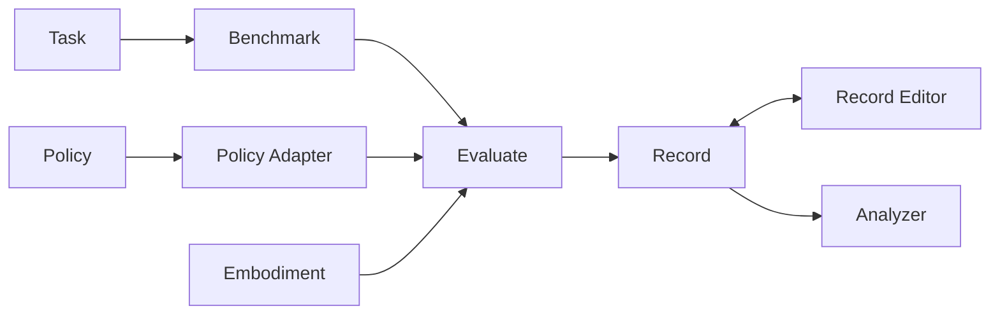

# 0088: The paper architecture

Status: in progress (phases 1 to 6, 8 and 9 built). One breaking release, built and tested phase by phase.

Inspect Robots accompanies a paper that defines an evaluation framework for
physical AI safety in eight extensible abstractions around one fixed backbone.
This plan makes the library match that definition, so the paper's terms name
real types, every box in its architecture figure has a module, and a reader can
go from the paper to the code without a translation table.

## 1. Target architecture

Evaluate is the fixed backbone: it automates setup, execution, termination,
data collection and analysis. Everything else is an extension point.

| Abstraction | Definition the implementation must match |
|---|---|
| Benchmark | A sequence of tasks. |
| Task | A scene (physical or simulated), an instruction, one or more rubrics, a time budget, and a number of trials. May carry metadata such as seeds. |
| Trial | One execution of a task. |
| Policy | $\pi = (O, A, F)$: $O$ the accepted observations, $A$ the available actions including terminal actions (such as give up) that end the trial, and $F: O \times S \to A^{+} \times S$ mapping an observation and internal state to an action chunk and a new state. |
| Policy Adapter | Extends the policy abstraction to multimodal language models: preprocessed observations, instructions for operating the current embodiment, a library of control tools (each call yields a sequence of actions) and a library of termination tools (done, give up with a stated reason). |
| Action Manager | Receives the action chunk. Each time an action completes, decides whether to execute the next action or rerun the policy on the latest observation. |
| Guards | An ordered sequence. Each reviews an action before execution and may modify it, or reject it and abort the trial (for example clipping to operating limits, or capping per-action motion). |
| Embodiment | A platform and control stack with a policy interface (observation space, action space) and an evaluation interface (between-trial reset, homing). One pair of (morphology and control stack, policy interface) is one embodiment. |
| Record | One per trial: the experimental configuration, every observation passed to the policy, every action chunk the policy produced, and the termination reason. |
| Record Editor | Read-write access for post-processing and annotation (for example a safety judgement). |
| Analyzer | Read-only access for general analysis, as composable, shareable modules. |

## 2. Where each abstraction lives today

| Abstraction | Today | Gap |
|---|---|---|
| Task | `task.Task`: scenes, scorer(s), one `max_steps`/`max_seconds` horizon, `Epochs`. `scene.Scene` has instruction, target, seed, setup, metadata. | Rubrics are not first class: one free-text rubric in `scene.metadata["rubric"]`, no link from a scorer to a named rubric, results not keyed by rubric. |
| Benchmark | `eval_set()` takes a list of tasks. | No named, registrable, versioned object. |
| Policy | `policy.Policy` / `PolicyBase`: `info`, `reset()`, `act()` returning an `ActionChunk`. | Terminal actions are not part of $A$: they ride on `action.meta["request_stop"]`, and the record cannot tell done from gave up from refused. |
| Policy Adapter | Inside the agent plugin (`LLMAgentPolicy`, its toolset). | Not a core abstraction; every language-model adapter re-implements the tools, and embodiments cannot contribute tools. |
| Action Manager | `controller.Controller.next_action()`; default, smoothing and ensembling controllers. | Replans only on a fixed interval; no hook for "rerun the policy now because the observation says so". |
| Guards | `approver.Approver.review()`; clamp, delta limit, chain; embodiment contributions. | Matches the paper apart from naming, configuration and a registry kind. |
| Embodiment | `embodiment.Embodiment`: `info`, `reset()`, `step()`, `close()`. | No evaluation interface: homing, parking, health and readiness are folded into reset/close or left to plugins. One embodiment switches its policy interface by option instead of being two embodiments. |
| Record | `rollout.TrialRecord` inside `log.EvalLog`, frames in `FrameStore`, an actions side-car. | Action chunks as the policy produced them are not recorded (only executed actions); records have no identity of their own; configuration lives at eval level. |
| Record Editor | `grader.Grader` mutates the record before scoring. | Edits are not separated from raw data, have no provenance, and cannot happen after the run. |
| Analyzer | CLI `summarize`, `view`, `inspect`. | No analyzer interface, read-only view or registry kind. |
| Evaluate | `eval()`, `eval_set()`, rollout, session, compatibility, conformance, sinks. | Must call the embodiment's evaluation interface between trials and enforce the task's time budget uniformly. |

The backbone, Policy, Guards and Action Manager already match. The work is
first-class rubrics and benchmarks, terminal actions, a core policy adapter
with tool libraries, the embodiment evaluation interface, records with chunks
and identity, and the editor/analyzer split.

## 3. Phases

Each phase is a series of small commits with its own design note where the
change is non-trivial, changelog fragments, tests at 100% coverage, and
`inspect_robots.__all__` plus `tests/test_api_snapshot.py` updated together.

1. **Vocabulary.** `Controller` becomes `ActionManager`, `Approver` becomes
   `Guard`, `TrialRecord` becomes `Record`, with no aliases. First-party
   plugins move in the same change and raise their minimum core version.
2. **Rubrics and the task budget.** `Rubric(name, text, kind, scorer,
   metadata)`; `Task.rubrics` with a per-scene override; results keyed by
   rubric name; log schema 2, reading schema 1 by mapping the old score and
   `scene.metadata["rubric"]` to a rubric named `default`. The record reports
   which bound ended the trial.
3. **Terminal actions.** `ActionChunk.terminal: Termination | None` with
   `Termination(kind, reason)`; `PolicyInfo.terminal_actions`; the rollout ends
   the trial after the chunk and records the kind and reason. The old
   `request_stop` meta keeps working. Embodiment termination still wins. Policy
   state stays inside the policy object; a stateful `act()` satisfies $F$.
4. **Embodiment evaluation interface.** Optional, duck-typed `home()`,
   `park()`, `health() -> HealthReport`, `prepare_trial(scene) -> Readiness`,
   called by Evaluate between trials, after faults and on close.
   `EmbodimentInfo.morphology`; embodiments sharing a morphology must declare
   distinct policy interfaces (checked by the conformance kit).
5. **Core policy adapter and tool libraries.** NumPy-only `Tool`,
   `ToolLibrary`, `control_tools(info)`, `termination_tools()` and a
   `PolicyAdapter` protocol owning observation preprocessing, embodiment
   instructions and the two tool libraries. Embodiments may
   `contribute_tools()`. The agent plugin keeps only its provider wire formats;
   CaP-X moves onto the same adapter. As built: the agent keeps its prompts and
   conversation as well as its wire formats, and gets tools, embodiment
   instructions and observation text from the core `ToolAdapter`; CaP-X,
   whose model writes code rather than calling tools, shares the adapter's
   embodiment-notes and state-line helpers. Golden request bodies are
   byte-identical across the move.
6. **Replanning on observation.** An optional `ReplanTrigger` protocol on the
   default action manager (built in: chunk end, unreachable target, gripper
   slip), with the reason recorded. As built: chunk end is the default and
   needs no trigger; a firing trigger adds `extra["replan"]` to the observation
   the policy sees and a `replan` event to the record.
7. **Guards as configuration.** Registry kind `guard`, `--guard NAME[:k=v]`
   and a `[guards]` config section; guard name and before/after action in the
   record.
8. **Records with identity and chunks.** `record_id`, the resolved per-trial
   configuration (credentials excluded), and the produced chunks with inference
   latency; a per-trial directory; log schema 3, still reading 1 and 2.
   Record events are persisted, including the `policy_terminal` event (kind,
   reason and step). Schema 2 logs keep only operator messages, so the log
   shows that a policy ended a trial but not the event that ended it.
9. **Record editors and analyzers.** Raw records become immutable; edits are
   annotations beside them with provenance; graders become editors that write
   annotations only; `inspect-robots edit`, `score` and `analyze`;
   `summarize` and `view` become analyzers. As built: the `Grader` API is
   unchanged, and the judgement it captures is read back as an annotation
   authored by the grader, which is what makes old logs score the same way
   (decision 2). Edits go to an append-only `<log>.annotations.jsonl`.
   `summarize`'s offline digest and `view`'s page ship as the `digest` and
   `html` analyzers, and both commands stay.
10. **Benchmark.** `Benchmark(name, tasks, version, metadata)`, registry kind
    `benchmark`, `run --benchmark`. Example benchmarks ship outside core.

Order: 1, 3, 2, 4, 8, 9, 5, 6, 7, 10.

## 4. Testing

Batch 0 (done before any phase) fixes the baselines every later phase is
measured against:

- **Golden request bodies** (`plugins/inspect-robots-agent/tests/test_wire_golden.py`):
  one fixed trial over every HTTP wire, with images hashed and the clock fixed.
  A diff is a real change to the prompt, the tool schemas or the observation
  text. Phase 5 must leave these files byte-identical.
- **A log corpus** of real schema-1 logs covering every termination reason, an
  embodiment fault, operator judgements and a wrapped policy. Logs from real
  runs carry private instructions and transcripts, so the corpus is kept by the
  maintainers outside the repository; schema-migration tests in the repository
  use synthetic logs of the same shapes.
- **A hardware baseline:** one bimanual tabletop task run with a language-model
  policy through the agent plugin, repeated after each phase that changes
  robot-facing behaviour.

Tiers, run as each phase requires:

| Tier | What |
|---|---|
| T1 | Every repository gate on Python 3.11, 3.12 and 3.13, plus the core-only import check. |
| T2 | Mock end-to-end: the CubePick world, the golden request bodies, the log corpus round trip. |
| T3 | Downstream readers of `EvalLog` JSON (launchers, importers, report scripts) run against new logs. |
| T4 | Hardware smoke test on a real embodiment. |
| T5 | Annotate after the fact, re-score, and match the stored scores (phase 9). |

| Batch | Phases | Must pass |
|---|---|---|
| 1 | 1, 3, 2 | T1, T2 (golden diff limited to the stop signal), T3, T4 with done, give up and operator stop. |
| 2 | 4 | T1 including the conformance kit, T4 with back-to-back trials, an aborted trial that parks, and a failed health check. |
| 3 | 8, 9 | T1, corpus read across schemas 1 to 3, re-scoring reproduces stored scores, T3, T4, T5. |
| 4 | 5, 6 | T1, golden files unchanged across the tool move, T4 across several model families. |
| 5 | 7, 10 | T1, T2, T4 running a benchmark end to end. |

## 5. Rules for every phase

- The release is the public library. Nothing specific to one lab's
  installation or one experiment goes in: no host names, device serials,
  people, measured rig numbers, run data or per-model workarounds. A fix found
  on hardware lands as a general mechanism (for example a per-request timeout
  option, not a timeout for one model).
- Core stays NumPy-only; new dependencies are optional extras.
- Gates: `ruff check`, `ruff format --check`, `mypy --strict` over `src` and
  `tests`, `pytest --cov` at 100%.
- The binding resolutions in plan 0001 sections 9 to 11 still hold. R6
  (judgement captured once, read by scorers) extends naturally: annotations
  are the recorded judgements.
- Renames are breaking and ship in one release with a migration table. Every
  log schema bump keeps reading older logs.
- Plugins with static versions are bumped in the change that touches them.
  The YAM plugin lives in its own repository and gets paired changes in
  phases 4 and 5.

## 6. Decisions

1. Rename as a breaking change, with no aliases.
2. Annotations replace in-record grading; a converter lifts old in-record
   grades into annotations so existing logs still score.
3. A reference record editor ships as a separate plugin; core defines only
   the annotation format.
4. Per-scene rubric overrides stay (a scene's rubrics replace the task's by
   name), since per-task rubrics alone would remove existing behaviour.
5. All phases ship together as one release accompanying the paper.
